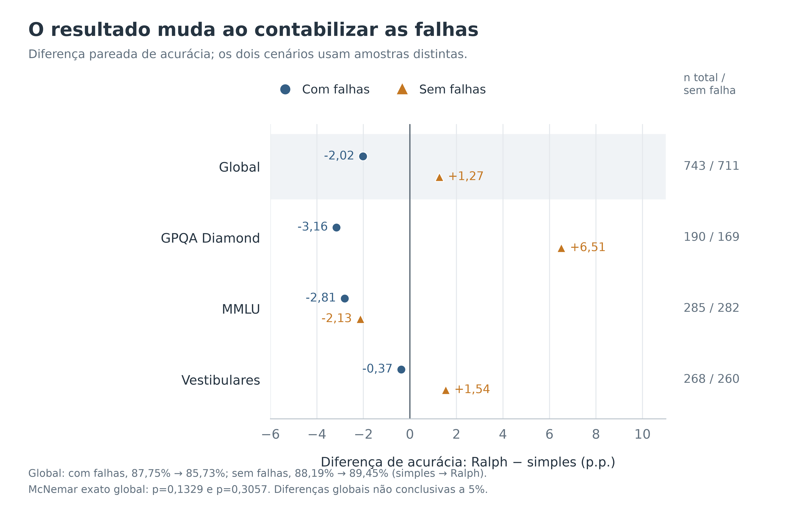
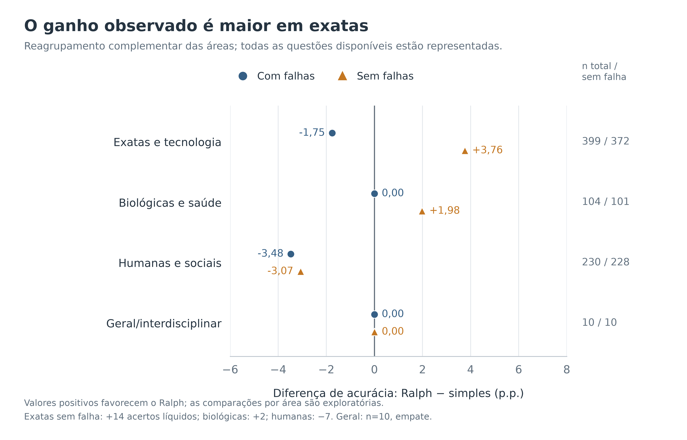
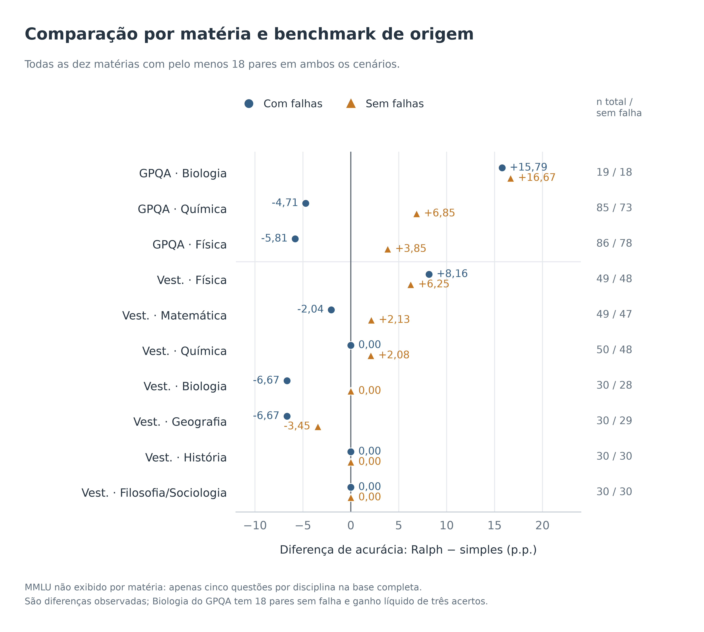
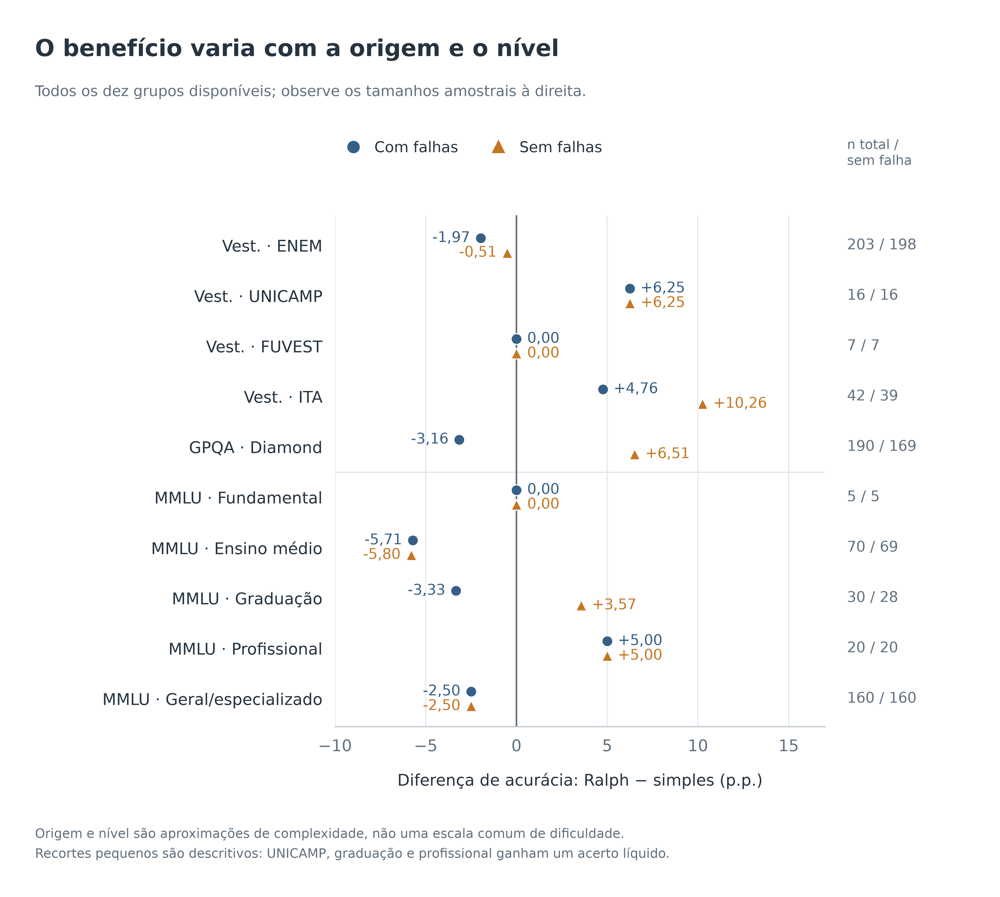
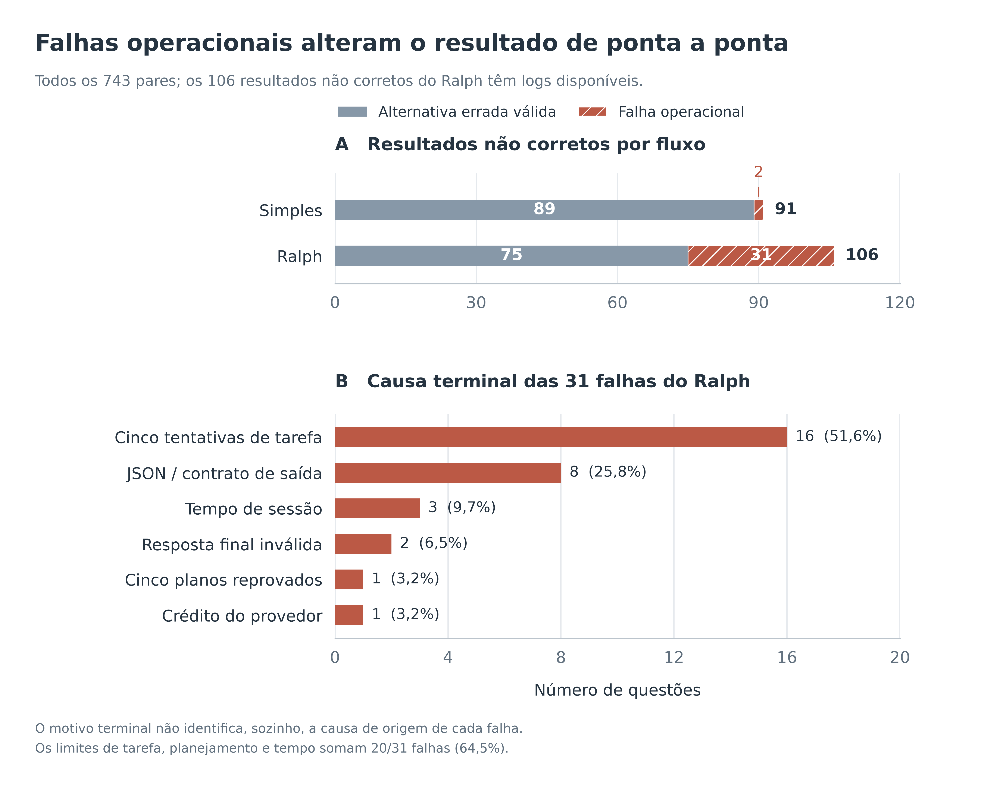
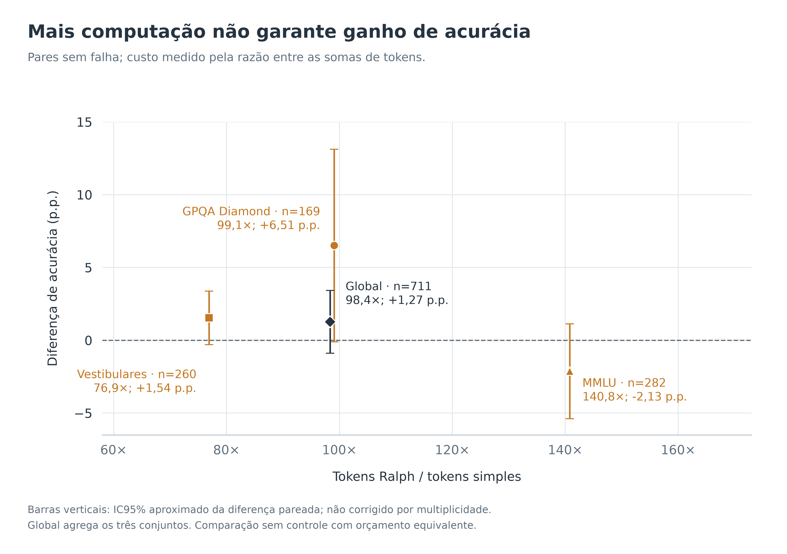

# Figuras para os resultados e a conclusão do paper

Este documento reúne seis figuras baseadas nos mesmos CSVs e logs da análise detalhada. Ele é independente: o relatório original e os arquivos de entrada foram preservados. As figuras usam diferenças pareadas de acurácia, amostras identificadas e a mesma definição de falha da análise.

**Para uma conclusão curta:** priorize a Figura 1, que resume o ganho e sua dependência das falhas, e a Figura 5, que explica a perda operacional. A Figura 2 resume as frentes de conhecimento; a Figura 3 detalha as matérias e a Figura 4 trata de origem e nível. Use a Figura 6 quando discutir viabilidade e custo. As seis são opções de apresentação, não uma recomendação de colocar seis figuras na conclusão.

As figuras têm largura de 7,8 polegadas, adequada à largura de duas colunas após pequeno redimensionamento. Use o **SVG** para manter nitidez em qualquer escala e o **PNG a 600 dpi** quando o editor exigir imagem raster. Títulos e rótulos estão em português. A escolha de cores é acompanhada por formas de marcadores e, na Figura 5, por hachura, para facilitar a leitura em escala de cinza.

## Figura 1. Resultado global e por benchmark




[PNG 600 dpi](graficos_paper/01_resultado_global_e_benchmarks.png) · [SVG vetorial](graficos_paper/01_resultado_global_e_benchmarks.svg)

**Legenda sugerida para o paper.** Diferença de acurácia entre o Ralph Loop adaptado e a inferência simples no conjunto global e nos três benchmarks. Valores positivos favorecem o Ralph. O cenário completo contabiliza falhas como resultados não corretos; o cenário sem falhas exclui o par inteiro se algum fluxo apresentar erro de execução ou resposta inválida. A coluna à direita informa os tamanhos das duas amostras. O ganho global observado muda de −2,02 p.p. em 743 pares para +1,27 p.p. em 711 pares; os testes de McNemar exatos bicaudais não são conclusivos a 5% (p=0,1329 e p=0,3057, respectivamente).

**Mensagem que a figura sustenta:** o ganho condicional concentra-se no GPQA e nos vestibulares; o MMLU continua desfavorável sem falhas. Os dois cenários têm amostras diferentes, portanto a distância entre os marcadores não é uma estimativa causal isolada do efeito de corrigir as falhas.

## Figura 2. Comparação entre frentes do conhecimento




[PNG 600 dpi](graficos_paper/02_areas_do_conhecimento.png) · [SVG vetorial](graficos_paper/02_areas_do_conhecimento.svg)

**Legenda sugerida para o paper.** Diferenças observadas de acurácia por área, segundo o reagrupamento complementar da análise: exatas e tecnologia, biológicas e saúde, humanas e sociais e geral/interdisciplinar. As categorias são mutuamente exclusivas e cobrem os 743 pares disponíveis. Exatas e tecnologia apresenta o maior ganho sem falhas (+3,76 p.p.; +14 acertos líquidos), seguido de biológicas e saúde (+1,98 p.p.; +2); humanas e sociais apresenta perda (−3,07 p.p.; −7). Os dez pares de geral/interdisciplinar empatam em 100% nos dois fluxos.

**Mensagem que a figura sustenta:** a frente com maior melhoria comparativa é exatas; biológicas apresenta benefício menor e humanas mantém perda. Isso descreve melhoria sobre a simples, e não um ranking de acurácia final. A análise é exploratória: o p nominal de exatas sem falhas (0,0336) não resiste à correção de Holm entre as quatro áreas (p ajustado=0,1342). As regras de classificação permanecem as do relatório: psicologia em humanas, sexualidade/envelhecimento em biológicas e negócios em humanas; não são categorias oficiais novas dos benchmarks.

## Figura 3. Comparação por matéria




[PNG 600 dpi](graficos_paper/03_comparacao_por_materia.png) · [SVG vetorial](graficos_paper/03_comparacao_por_materia.svg)

**Legenda sugerida para o paper.** Diferença de acurácia nas dez matérias que possuem pelo menos 18 pares em ambos os cenários. São apresentadas todas as matérias elegíveis: três do GPQA e sete dos vestibulares. As 57 matérias do MMLU têm cinco pares cada na base completa e não entram neste gráfico; seu resultado agregado está na Figura 1. O critério de inclusão depende do tamanho amostral, não do sinal do resultado. Rótulos preservam o benchmark de origem para impedir a fusão silenciosa de matérias distintas.

**Mensagem que a figura sustenta:** Biologia do GPQA tem o maior ganho percentual sem falhas (+16,67 p.p. em 18 pares), e Química do GPQA tem o maior ganho líquido entre essas matérias (+5). Física dos vestibulares melhora nos dois cenários; Geografia perde nos dois. O grande ganho percentual de Biologia do GPQA equivale a três acertos líquidos em uma amostra pequena, não demonstração de superioridade em toda a Biologia. Os pontos representam estimativas observadas; não há barras de incerteza ou declaração de significância por matéria.

## Figura 4. Origem e nível das questões




[PNG 600 dpi](graficos_paper/04_origem_nivel_e_complexidade.png) · [SVG vetorial](graficos_paper/04_origem_nivel_e_complexidade.svg)

**Legenda sugerida para o paper.** Diferença de acurácia por origem das questões dos vestibulares, GPQA Diamond e nível nominal das matérias do MMLU. Todos os dez grupos disponíveis são exibidos. O ITA apresenta ganho de +4,76 p.p. com falhas e +10,26 p.p. sem falhas; o GPQA Diamond muda de −3,16 para +6,51 p.p. O ENEM permanece desfavorável. Os tamanhos amostrais são indicados, incluindo FUVEST (n=7), ensino fundamental MMLU (n=5) e os demais recortes pequenos.

**Mensagem que a figura sustenta:** problemas de algumas origens mais exigentes mostram ganhos promissores, mas também risco de falha. Origem e nível são indicadores aproximados; a disposição categórica não é uma escala uniforme de dificuldade. No MMLU, não há tendência monotônica com o nível. A melhora sem falhas em graduação, profissional e UNICAMP corresponde a apenas um acerto líquido em cada grupo.

## Figura 5. Erros e causas das falhas




[PNG 600 dpi](graficos_paper/05_erros_e_causas_das_falhas.png) · [SVG vetorial](graficos_paper/05_erros_e_causas_das_falhas.svg)

**Legenda sugerida para o paper.** (A) Resultados não corretos nos 743 pares, separados entre alternativa válida divergente do gabarito e falha operacional. A inferência simples tem 89 alternativas erradas válidas e duas falhas (91 erros no total); o Ralph tem 75 alternativas erradas válidas e 31 falhas (106 no total). (B) Classificação terminal das 31 falhas Ralph: 16 esgotamentos de tentativas de tarefa, oito falhas de JSON/contrato, três estouros de tempo, duas respostas finais inválidas, um esgotamento de planejamento e um bloqueio de crédito do provedor. As porcentagens do painel B usam 31 como denominador.

**Mensagem que a figura sustenta:** as falhas operacionais revertem o benefício observado entre as saídas válidas. O bloqueio de crédito é apenas uma das 31 ocorrências; não há suporte para justificar todas as perdas como indisponibilidade externa. Motivo terminal não equivale a causa única: os limites podem decorrer de premissas erradas, critérios inadequados e ausência de revisão das dependências. A comparação de 89 e 75 erros válidos é descritiva: os fluxos não entregaram saídas válidas exatamente nas mesmas questões. Além das falhas, existem 26 regressões válidas do Ralph na comparação pareada.

## Figura 6. Ganho de acurácia e custo computacional




[PNG 600 dpi](graficos_paper/06_custo_e_ganho_de_acuracia.png) · [SVG vetorial](graficos_paper/06_custo_e_ganho_de_acuracia.svg)

**Legenda sugerida para o paper.** Relação entre a razão de tokens Ralph/simples e a diferença de acurácia nos pares sem falha. A razão é calculada entre as somas de tokens de cada fluxo no mesmo recorte. As barras verticais representam intervalos de 95% aproximados da média das diferenças pareadas (−1, 0, +1), sem correção por múltiplas comparações. O ponto global agrega os três benchmarks e não constitui uma quarta observação independente. Todos os intervalos exibidos incluem zero; o teste de referência do relatório é o McNemar exato.

**Mensagem que a figura sustenta:** o maior consumo não acompanha necessariamente o maior ganho: o MMLU usa 140,80 vezes os tokens e perde 2,13 p.p. No global, são 98,36 vezes os tokens para ganho observado de 1,27 p.p., cerca de 4,60 milhões de tokens adicionais por acerto líquido. Não houve comparação com outra estratégia de orçamento equivalente; a figura não demonstra efeito causal da quantidade de tokens. O eixo horizontal tem escala linear e representa um diagrama de dispersão, não barras iniciadas em zero.

## Fontes e reprodução

As quatro primeiras figuras usam os dois CSVs originais. A classificação das falhas da Figura 5 usa os três ZIPs, conciliados com os 106 resultados não corretos do Ralph. A Figura 6 usa somente o CSV sem falhas. Os gabaritos e as exclusões são os mesmos do relatório; dez questões declaradas sem pares disponíveis continuam fora da análise. Não foram simulados ganhos após correções nem criados resultados novos.

O arquivo [dados_figuras.json](graficos_paper/dados_figuras.json) registra as métricas exibidas, hashes SHA-256 das fontes, configuração de exportação e versão do Matplotlib. O script [gerar_graficos_paper.py](gerar_graficos_paper.py) pode reproduzir as figuras com Python 3 e Matplotlib:

```bash
python3 analise/gerar_graficos_paper.py
```

Definições, intervalos aproximados, classificação das áreas e limitações seguem o [relatório detalhado original](RELATORIO_DETALHADO_RESULTADOS_RALPH_LOOP.md), que permanece inalterado. As comparações por matéria, área e nível são exploratórias. Nas Figuras 1 a 4, diferenças com e sem falha são mostradas como estimativas pontuais para evitar atribuir precisão excessiva a recortes pequenos; a Figura 6 explicita a incerteza nos conjuntos maiores.
