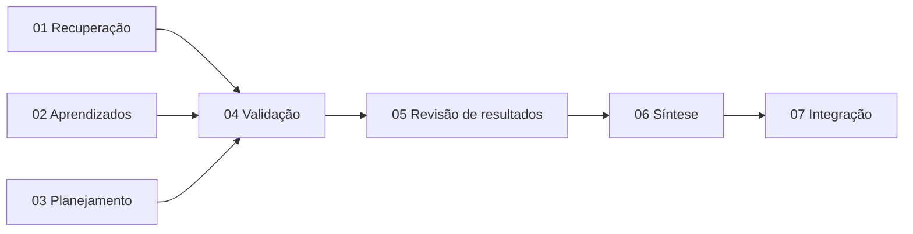

# Prompts de desenvolvimento — melhorias do Ralph Loop

Este diretório contém **sete prompts**, para execução por agentes diferentes, em sessões separadas, sobre o repositório atualizado. Cada prompt contém o contexto necessário; os agentes não precisam da conversa que originou o trabalho.

**Os prompts 01, 02 e 03 podem ser implementados em paralelo em worktrees separados.** Integre e valide os três antes de executar 04. Depois, execute **04 → 05 → 06 → 07**, integrando cada etapa antes da seguinte. A sequência totalmente serial 01 → 02 → 03 → 04 → 05 → 06 → 07 também é válida.

| Ordem | Prompt | Responsabilidade | Frente coberta |
|---|---|---|---|
| 01 | [Recuperação de saídas](01_recuperacao_de_saidas.md) | Remover corte de conteúdo na recuperação e preservar material necessário à correção | Estrutural |
| 02 | [Aprendizados pontuais](02_aprendizados_pontuais.md) | Preservar dados, referências, condições e conclusões entre contextos | Aprendizados |
| 03 | [Planejamento e critérios](03_planejamento_e_criterios.md) | Planejar sem assumir respostas e cobrir a determinação solicitada | Planejamento |
| 04 | [Validação e aproximações](04_validacao_e_aproximacoes.md) | Ajustar B.1/B.2/C.1 e a passagem a C.2, conciliando flexibilidade e correção | Validação e cobertura após recuperação |
| 05 | [Revisão de resultados aprovados](05_revisao_de_resultados_aprovados.md) | Permitir investigar contradições e manter resultados e memória vigentes coerentes | Estrutural e validação |
| 06 | [Fidelidade da síntese](06_fidelidade_da_sintese.md) | Preservar o conteúdo aprovado ao apresentar a resposta em C.3 | Síntese final |
| 07 | [Integração e regressões](07_integracao_e_regressoes.md) | Exercitar as cinco frentes juntas e corrigir incompatibilidades | Transversal às cinco frentes |

## Paralelismo e dependências

As setas representam os pontos de integração antes de iniciar o prompt seguinte. O encadeamento transmite também as dependências anteriores.

| Prompt | Pré-requisito para iniciar a implementação completa | Motivo |
|---|---|---|
| 01 | Nenhum dos demais prompts | Altera principalmente a recuperação em `base_thinking_phase.py` |
| 02 | Nenhum dos demais prompts | Altera principalmente A.3/B.4 e preservação da memória, sem exigir recuperação nova |
| 03 | Nenhum dos demais prompts | Altera principalmente A.1/A.2/C.2/B.1; o alinhamento da recuperação com 01 é conferido na integração |
| 04 | 01, 02 e 03 integrados | Validação deve julgar os novos critérios, notas e cobertura após recuperação com instruções coerentes |
| 05 | 04 integrado, incluindo seus pré-requisitos | Implementa o protocolo de revisão e seus efeitos sobre resultados, memória e aprovação global |
| 06 | 05 integrado, incluindo seus pré-requisitos | A síntese precisa consumir a representação definitiva dos resultados e aprendizados vigentes |
| 07 | Todos os anteriores integrados | Exercita os contratos e transições finais das cinco frentes |

### Divisão do trabalho na primeira rodada

- **Worktree de 01:** responsável por `base_thinking_phase.py`, mensagens de recuperação e testes dessa recuperação. A orientação de conferir cobertura na correção de A.2/C.2 também pertence a 01.
- **Worktree de 02:** responsável por `a3_planning_learnings.md`, `b4_learnings_extraction.md`, memória e transporte das notas. Não alterar a recuperação ou a política de planejamento/validação de outras fases.
- **Worktree de 03:** responsável por `a1_general_criteria.md`, `a2_task_decomposition.md`, `c2_additional_planning.md` e alinhamento de escopo em `b1_task_resolution.md`. Não alterar `base_thinking_phase.py` em paralelo a 01; a preservação/cobertura da recuperação é entregue por 01.

Testes novos de integração devem preferir arquivos próprios por frente. Não reformatar arquivos compartilhados nem mudar schemas, assinaturas ou helpers comuns sem necessidade. Se uma mudança de contrato compartilhado for indispensável, registre a dependência e integre a alteração antes de concluir o trecho dependente da outra branch; isolamento de worktree não elimina dependências de contrato.

### Integração das worktrees

1. Crie três branches/worktrees a partir do mesmo commit que contenha estes prompts. Arquivos não commitados ou ignorados não são copiados automaticamente para novas worktrees; as instruções não dependem das exportações locais do benchmark.
2. Execute 01, 02 e 03 nas respectivas worktrees. Cada agente roda seus testes e as verificações exigidas no seu estado de trabalho.
3. Integre as branches em uma branch de integração, preferencialmente na ordem 01, 02, 03. Essa ordem simplifica a conferência; não impede o desenvolvimento simultâneo.
4. Resolva conflitos preservando as três mudanças. Conflitos prováveis: documentação, testes compartilhados e montagem de variáveis no orquestrador. Verifique também incompatibilidades sem conflito textual.
5. Execute lint e a suíte completa do backend no resultado combinado. Só então crie/atualize a worktree de 04 a partir desse estado integrado.
6. Repita integração e validação após 04, 05 e 06. Execute 07 sobre o conjunto completo.

Cada agente continua documentando sua seção em `NOVAS_REGRAS_RALPH_LOOP.md`, além das atualizações exigidas nos demais documentos. Como as branches partem da mesma base, anexar seções ao fim do mesmo arquivo pode gerar conflitos: mantenha todas as seções, ordene-as por número e harmonize as descrições do comportamento vigente. Não substitua o documento pela versão integral de uma única branch.

O paralelismo integral de 04/05/06 não é recomendado com os prompts atuais: eles compartilham C.1/C.2, orquestrador, schemas e estado vigente. É possível antecipar leitura ou rascunhos, mas a implementação completa e sua validação dependem dos resultados anteriores.

## Decisões que todos os agentes devem preservar

- O harness é **generalista**. Múltipla escolha é um instrumento de avaliação; perguntas abertas também devem funcionar.
- Foi **rejeitada** a injeção de `question.options` ou de qualquer campo especializado do benchmark no núcleo do thinking para contornar A.3. Aprendizados devem vir das fontes textuais previstas no fluxo.
- Aproximações, inferências interpretativas e seleção por melhor ajuste ou eliminação continuam válidas. Ausência de coincidência exata não é reprovação automática; contradição demonstrável e análise essencial ausente não devem ser encobertas por uma escolha.
- Não criar nova fase de LLM, pós-validador de C.3 ou execução paralela de agentes dentro da aplicação por padrão. Usar A.1–A.3, B.1–B.4 e C.1–C.3, com C.2 quando necessário.
- Cobertura do plano é uma propriedade semântica, não uma contagem de tarefas. Sua revisão deve ser explicitada em A.2/recuperação; a suficiência dos resultados continua sendo verificada em C.1.
- TDD é obrigatório, com testes dos comportamentos programáticos e dos contratos de prompts. Respostas roteirizadas de um fake não provam que um modelo real raciocina corretamente.
- Os prompts internos são escritos em **inglês**, em arquivos Markdown, mantendo o envelope JSON exigido pela fase. A resposta final segue o idioma solicitado pelo usuário.
- `NOVAS_REGRAS_RALPH_LOOP.md` **já existe na raiz**. Cada agente deve acrescentar sua seção identificada e preservar as anteriores. Não criar arquivo sem extensão, versão alternativa ou substituição do documento inteiro. Atualizar as extensões de `RALPH_LOOP_ADAPTADO.md` sem alterar a transcrição literal do paper.

## Uso

Envie a um agente o conteúdo integral de um dos sete arquivos. Os caminhos citados nos prompts são relativos à raiz do repositório. O agente deve executar a implementação daquela etapa, inclusive testes, documentação e relato da validação; não apenas propor um plano.

O relatório `RELATORIO_BENCHMARK_VESTIBULARES_736136f4.md` e a exportação `benchmark-session-bench_736136f41a3d4f09bee4e50eaca509c5-ralph-loop-errors/` contêm evidências adicionais, quando disponíveis. A implementação e os testes não devem depender da presença desses arquivos locais: os casos necessários estão descritos nos prompts e devem virar fixtures pequenas e versionáveis.

## Condição de conclusão

As cinco frentes só estão integradas depois do prompt 07. O resultado deve incluir casos de perguntas abertas, aproximações válidas, reprovação de contradições, complementação de análise ausente, revisão auditável de resultados e síntese fiel. Não considerar uma mudança de prompt uma garantia de melhora na acurácia; registrar separadamente verificações determinísticas e avaliação semântica com modelos reais.
